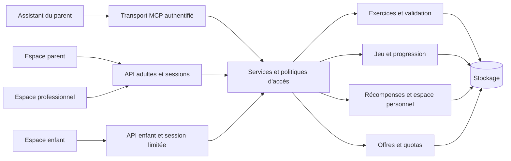

# Architecture de Lumo

Décisions du 9 octobre 2026. Ce document distingue le code actuel de la cible. Les espaces professionnels et la facturation ne sont pas encore implémentés.

## 1. Décision générale

Conserver une application serveur unique organisée en modules, avec un navigateur enfant et des interfaces adultes distinctes. Le MCP est une porte d'entrée vers les mêmes règles métier que le Web ou une future API de génération. Il ne doit pas disposer d'un circuit de publication moins strict.

Le serveur détient l'état réel : autorisations, exercices publiés, tentatives, progression, récompenses. Le navigateur présente cet état et conserve uniquement des préférences et des caches remplaçables. Les messages de l'IA et les paramètres du navigateur sont des données à valider.

SQLite reste adapté au prototype sur une seule machine. Un passage à PostgreSQL sera évalué avant un hébergement avec plusieurs instances ou une charge importante en écritures. Le nombre d'inscrits seul ne suffit pas à décider : il faut mesurer la concurrence et les temps de réponse. Ne pas partager un fichier SQLite via un disque réseau.

Les espaces parent et professionnel complets, leurs sessions et les services commerciaux de ce schéma sont la cible, pas des fonctions déjà livrées.

## 2. Personnes, familles et organisations

Un adulte peut être parent ET professionnel. Éviter un champ unique `type_utilisateur` qui l'obligerait à choisir un rôle exclusif.

Modèle cible :

| Entité | Rôle |
|---|---|
| `utilisateurs` | Identité adulte liée au fournisseur d'authentification ; aucun mot de passe en clair dans Lumo. |
| `familles` | Périmètre propriétaire des profils enfant et de leurs exercices. |
| `membres_famille` | Lien utilisateur/famille, rôle et état d'invitation ; permet plusieurs responsables. |
| `enfants` | Profil pédagogique minimal rattaché à une famille ; pas de compte adulte. |
| `organisations` | Cabinet d'abord ; école ensuite, avec un type d'organisation explicite. |
| `membres_organisation` | Identité et rôle dans un cabinet ou une école. Un administrateur de facturation n'obtient pas automatiquement accès aux enfants. |
| `autorisations_enfant` | Partage explicite d'un profil avec un professionnel, droits, auteur de l'accord, échéance et révocation. |
| `invitations` | Jeton haché, usage unique, expiration et destinataire ; pas d'accès avant acceptation. |
| `sessions` | Session adulte ou enfant ; contexte établi côté serveur, durée limitée et révocation. |
| `journal_acces` | Qui a fait quoi, sur quel périmètre et quand, sans recopier le contenu des leçons. |

Le modèle actuel `parents`/`enfants.parent_id` est une séparation de prototype. Il ne faut pas ajouter `professionnel_id` directement sur l'enfant : plusieurs professionnels doivent pouvoir l'accompagner, et un même professionnel accompagne plusieurs familles.

### Priorité produit confirmée

1. Parents et enfants.
2. Logopèdes et professionnels du soin invités par les familles.
3. Enseignants, écoles, classes et groupes.

Les groupes scolaires seront une organisation des enfants déjà autorisés. Appartenir à une école ou à un groupe ne devra jamais ouvrir l'ensemble des profils du service.

## 3. Politique d'accès à appliquer sur chaque requête

| Action | Parent autorisé | Enfant | Professionnel invité |
|---|---|---|---|
| Jouer | Accès à la vue enfant si prévu | Ses exercices publiés | Non par défaut |
| Voir les statistiques détaillées | Enfants de sa famille | Non | Seulement si ce droit a été accordé |
| Préparer des exercices | Oui | Non | Oui si autorisé pour cet enfant |
| Publier des exercices | Validation parentale | Non | Proposition au parent ; pas de publication par défaut |
| Partager ou révoquer un accès | Responsable de la famille | Non | Non |
| Modifier l'offre commerciale | Payeur concerné | Non | Pour son propre abonnement ou son organisation |

Règle centrale : identité vérifiée + appartenance au périmètre + droit actif sur la ressource. Aucun `parent_id`, `enfant_id` ou `organisation_id` envoyé par le navigateur ne constitue une preuve d'autorisation. Le service les résout et les vérifie.

La révocation doit prendre effet à la requête suivante, y compris pour une session déjà ouverte. Éviter les droits durables copiés dans un jeton impossible à révoquer rapidement. Les liens d'aperçu actuels sont des capacités privées : ils restent pratiques en démo, mais ne prouvent pas l'identité d'un parent et devront être rattachés à une session authentifiée.

## 4. Offres commerciales indépendantes des droits

Ne jamais écrire « abonnement pro = accès aux enfants ». Un professionnel gratuit conserve les mêmes contraintes de confidentialité qu'un professionnel payant.

Le futur modèle distingue :

- le rôle et les autorisations : ce que la personne peut consulter ou modifier ;
- l'offre : fonctionnalités et quotas disponibles pour le payeur ;
- la source de génération : assistant du parent via MCP, ou API prise en charge par Lumo ;
- la consommation : opérations réellement réservées/exécutées, avec identifiant unique.

Entités prévues : `offres`, `abonnements`, `droits_offre`, `consommations`. Un abonnement appartient à un utilisateur, une famille ou une organisation selon un contrat explicite, pas à un enfant. Les webhooks du prestataire de paiement devront être signés et traités une seule fois. Aucun prix n'est fixé dans le code métier.

## 5. Exercices et qualité pédagogique

Le circuit commun est : source → proposition → validation structurelle → aperçu adulte → validation parentale → publication immuable → réponses enfant.

`src/formats.ts` borne les champs ; `verifierQuetes` vérifie la cohérence des jeux ; le parent vérifie la pertinence. Aucun de ces contrôles ne garantit à lui seul que l'IA a correctement lu une photo. Les extraits sont déclarés par l'assistant.

À construire avant la génération intégrée : version du contrat de contenu, version du générateur, lien entre proposition et source, motif de correction/rejet, support de lecture ou image explicitement affiché à l'enfant lorsque la question en dépend. Modifier un exercice déjà joué doit créer une nouvelle version ; les statistiques anciennes conservent leur contexte.

Ne pas supposer qu'une bonne consigne pour six ans convient à douze ans. Niveau scolaire, niveau de lecture, aide audio et goûts doivent être indépendants. Ne pas déduire un diagnostic à partir des erreurs de jeu.

## 6. Progression, récompenses et espace personnel

Le code actuel garantit des tentatives persistées, une étoile au plus par question réussie et une fin de quête atomique. Une question se termine après une réussite ou deux essais avec aide. Une reconnexion reprend les questions restantes. Une même requête ne compte pas deux fois.

L’espace personnel est implémenté dans `src/monde.ts` avec une connexion SQLite passée explicitement et un frontend isolé. Son fonctionnement est décrit dans [MONDE-ENFANT.md](MONDE-ENFANT.md). Il comprend :

- catalogue d'objets avec identifiants stables ;
- inventaire persistant par enfant ;
- événement d'attribution unique associé à une quête ;
- couleur d’avatar et écusson validés côté serveur ;
- déblocage contre une attribution gagnée, avec contrôle du solde dans la même transaction ;
- synchronisation entre appareils avec numéro de version pour détecter les conflits ;
- suppression/archivage d'un exercice sans retrait des objets déjà gagnés.

Les anciens objets de la chambre sont conservés dans « Mes souvenirs ». Les cadeaux du jardin, les ingrédients, les recettes commencées et le carnet sont persistés côté serveur. Les attributions ne dépendent plus de l'existence des anciennes quêtes ; le compteur d'étoiles pédagogique reste à rendre indépendant de leur suppression. Pas de tirage payant, de perte de récompenses pour une erreur ou de classement public entre enfants.

## 7. Voix et fournisseurs

Une phrase en cache est relue sans génération. Les nouvelles générations ElevenLabs sont désactivées par défaut, interdites en partage, bornées en concurrence et soumises à un budget quotidien persistant de caractères. Ce plafond est technique ; il ne représente pas le montant exact facturé.

Séparer progressivement un contrat de synthèse (`lireCache`, `generer`, `estDisponible`) du fournisseur utilisé. Une bibliothèque de phrases communes peut être préproduite. Les consignes nouvelles nécessitent toujours une synthèse dynamique ou une voix de l'appareil. Le navigateur peut utiliser une voix distante : ne pas présenter ce mode comme toujours hors ligne.

Avant de vraies familles : aucun endpoint enfant ne doit pouvoir commander des phrases arbitraires payantes. Il devra référencer un texte autorisé par un exercice ou un catalogue ; réserver les essais de voix aux adultes. Isoler les caches de textes propres à une famille, définir suppression/rétention et choisir les droits commerciaux des enregistrements.

## 8. Modules et évolution du code

Actuel : `config` et `migrations` pour l'infrastructure ; `formats` pour le contrat ; `logic` pour le jeu ; `parents` pour les brouillons ; `http`, `web`, `mcp-http`, `outils-mcp` pour les transports ; `voix` pour le service audio.

Prochaine séparation, au moment d'implémenter les espaces adultes : `identites`, `acces`, `familles`, `professionnels`, `exercices`, `progression`, `recompenses`, `offres`, `audio`. Les transports appellent ces services ; ils ne contiennent pas leurs propres variantes des règles. Les requêtes SQL seront regroupées par domaine, avec une connexion passée explicitement, plutôt que de multiplier les imports du singleton global.

L'espace personnel et son catalogue visuel sont séparés dans `public/espace-personnel.js`, `monde-art.js` et `monde.css`. Les écrans d'exercices, l'audio et les helpers historiques restent dans `public/app.js` et pourront être extraits progressivement. Une réécriture de framework n'est pas nécessaire.

## 9. Conditions pour un pilote réel

Pas d'inscription publique avant : authentification adulte/enfant et sessions testées ; invitations et révocations ; suppression/export/rétention des données ; hébergement HTTPS stable ; sauvegarde hors machine et restauration répétée ; journal d'accès ; limites de dépenses ; surveillance ; tests d'accès croisés ; validation des textes et des usages avec familles et professionnels.

Les droits scolaires, les consentements et les données éventuellement sensibles devront être précisés pour le contexte réel de déploiement. Ce document est un choix d'architecture technique, pas une validation juridique ou clinique.

## Références techniques

- [SQLite : cas d'usage et limites de concurrence](https://www.sqlite.org/whentouse.html)
- [SQLite : sauvegarde cohérente et VACUUM INTO](https://www.sqlite.org/backup.html)
- [Node : exécuter TypeScript ne vérifie pas ses types](https://nodejs.org/api/typescript.html)

## Espace personnel simplifié — 9 octobre 2026

`public/espace-personnel.js` remplace l’entrée UI de `monde.js`. Les routes historiques jardin/cuisine ouvrent l’avatar ; cadeau/carnet ouvrent collection/progrès. Les ateliers sont retirés du code actif et archivés dans le tag archive/avant-nettoyage-ateliers-2026-10-09 ; leurs données sont conservées. L’avatar est un champ JSON avec défaut compatible, validé côté serveur ; le port d’un écusson exige sa possession. Les achats réutilisent le registre, la transaction, la version et l’UUID existants. Le carnet compte les questions distinctes essayées des missions conservées et affiche les 20 dernières missions ; le total historique des missions terminées vient du compteur enfant. Aucune nouvelle dépendance, aucune nouvelle API payante.
